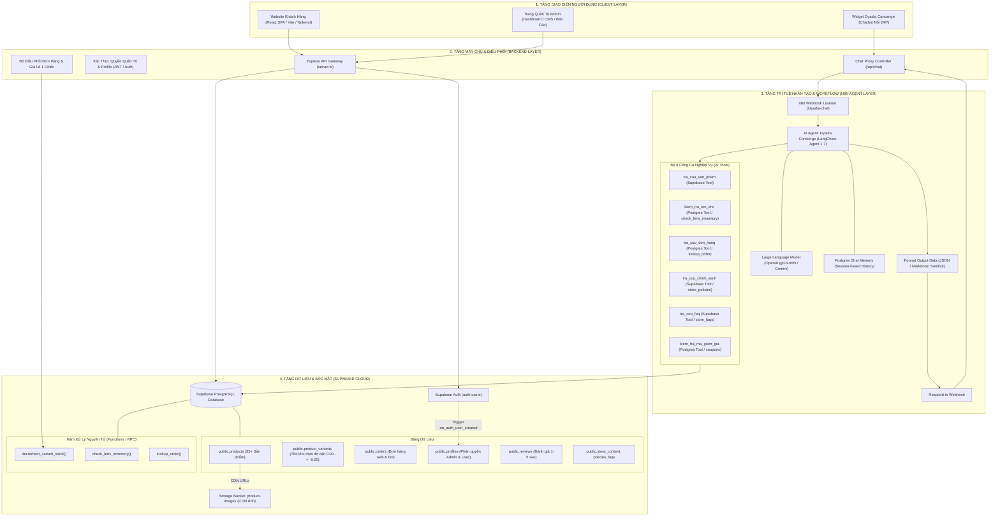
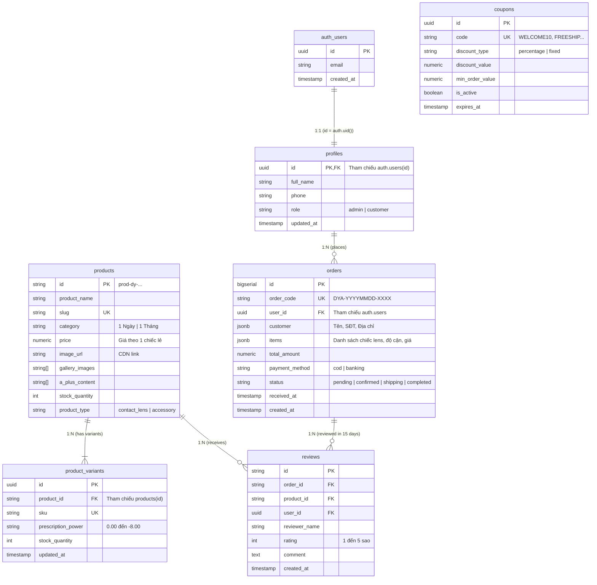
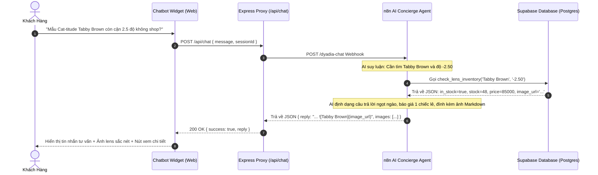
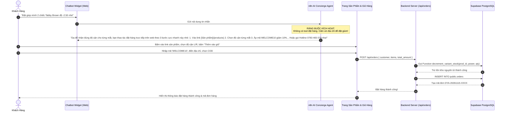

# KIẾN TRÚC TỔNG THỂ HỆ THỐNG WEBSITE THƯƠNG MẠI ĐIỆN TỬ & TRỢ LÝ ẢO AI CHATBOT DYADIA LENS

> **Dự án:** Hệ thống Thương mại Điện tử Kính Áp Tròng Hàn Quốc Dyadia Lens & Trợ lý Ảo AI Concierge  
> **Phiên bản:** 2.0 (Commercial Architecture Standard)  
> **Mô hình triển khai:** Decoupled Microservices / Serverless Data Layer + Workflow Automation  

---

## 1. TỔNG QUAN KIẾN TRÚC PHÂN TẦNG (HIGH-LEVEL 4-TIER ARCHITECTURE)

Hệ thống Dyadia Lens được thiết kế theo mô hình kiến trúc 4 phân tầng độc lập (**4-Tier Architecture**), đảm bảo tính module hóa, bảo mật đa lớp và khả năng mở rộng linh hoạt:

1. **Client / Presentation Layer (Tầng giao diện người dùng):** Ứng dụng Single Page Application (SPA) xây dựng trên nền tảng **React 18 + TypeScript + Vite + Tailwind CSS**, tích hợp widget Chatbot AI Concierge tương tác thời gian thực.
2. **Backend & Proxy Layer (Tầng máy chủ & Điều phối API):** Máy chủ **Node.js + Express**, đóng vai trò API Gateway, xử lý xác thực quyền quản trị (Admin RBAC), định giá lens lẻ, và làm cầu nối bảo mật giữa Frontend và n8n Webhook.
3. **AI Agent & Automation Orchestration Layer (Tầng trí tuệ nhân tạo & Tự động hóa n8n):** Hệ thống tự động hóa **n8n Workflow**, tích hợp LangChain Agent, LLM (OpenAI / Gemini), bộ nhớ hội thoại phiên làm việc (Postgres Chat Memory) và bộ 6 công cụ truy vấn dữ liệu nghiệp vụ (Tools).
4. **Data & Cloud Infrastructure Layer (Tầng dữ liệu & Lưu trữ đám mây Supabase):** Cơ sở dữ liệu quan hệ **Supabase PostgreSQL** với bảo mật cấp hàng (Row Level Security - RLS), các hàm xử lý nguyên tử (Stored Procedure / RPC), dịch vụ xác thực **Supabase Auth** và mạng phân phối nội dung ảnh **Supabase Storage CDN**.

---

## 2. SƠ ĐỒ KIẾN TRÚC TỔNG THỂ HỆ THỐNG (SYSTEM ARCHITECTURE DIAGRAM)

---

## 3. CHI TIẾT TỪNG PHÂN TẦNG CÔNG NGHỆ

### 3.1. Tầng Giao Diện (Presentation Layer)
* **Công nghệ chủ đạo:** React 18, TypeScript, Tailwind CSS, Lucide React, Vite Bundler.
* **Các module chức năng:**
  * **Trang chủ (Home):** Hero Carousel chuyển động, Bộ sưu tập nổi bật (*Cat-titude*, *Dolly*, *One&Only*), Bảng chọn nhanh theo nhu cầu, Lookbook Instagram thời thượng liên kết chính thức `@hapakristin.global`.
  * **Cửa hàng & Bộ lọc (Catalog & Filter):** Lọc theo bộ sưu tập, màu sắc (Nâu, Xám, Choco, Đen, Tím khói, Xanh rêu), chu kỳ sử dụng (1 Ngày, 1 Tháng) và khoảng giá.
  * **Chi tiết sản phẩm (Product Detail Page):** Chọn độ cận độc lập cho Mắt Trái / Mắt Phải, kiểm tra tình trạng tồn kho tức thì, hiển thị A+ Content phong cách K-Beauty.
  * **Giỏ hàng & Thanh toán (Cart & Checkout):** Hỗ trợ tính giá theo từng chiếc lẻ, áp dụng mã voucher (`WELCOME10`, `LENS50K`, `FREESHIP`), tính phí giao hàng tự động.
  * **Quản trị hệ thống (Admin Portal):** Quản lý 35 sản phẩm, chỉnh sửa biến thể tồn kho 23 độ cận, đổi trạng thái đơn hàng, duyệt đánh giá sản phẩm.
  * **Dyadia Concierge Widget:** Hộp thoại trò chuyện nổi góc màn hình, tự động kết nối n8n Webhook, hiển thị hình ảnh sản phẩm định dạng thẻ trực quan.

### 3.2. Tầng Máy Chủ Điều Phối (Backend Layer)
* **Công nghệ:** Node.js, Express Framework, TypeScript (`tsx server.ts`).
* **Vai trò an ninh:**
  * **Ẩn danh Webhook n8n:** Tuyệt đối không để lộ URL Webhook n8n ra ngoài trình duyệt khách hàng; mọi tin nhắn chat đều đi qua proxy `/api/chat` của server.
  * **Đảm bảo toàn vẹn giỏ hàng:** Máy chủ tự động tính toán lại tổng tiền từ ID sản phẩm và số lượng chiếc, ngăn chặn việc can thiệp giá từ phía client.
  * **Xác thực quyền Admin (RBAC):** Kiểm tra JWT Token và tra cứu cột `role = 'admin'` trong bảng `public.profiles` trước khi cho phép thực thi các API quản trị (`/api/admin/*`).

### 3.3. Tầng Trí Tuệ Nhân Tạo & Tự Động Hóa (AI Agent & n8n Layer)
* **Mô hình AI:** LangChain ReAct Agent (OpenAI Chat Model `gpt-5-mini` / `gpt-4o-mini` hoặc Google Gemini 2.5 Flash).
* **Bộ nhớ ngữ cảnh (Chat Memory):** Sử dụng `Postgres Chat Memory` liên kết qua bảng `n8n_chat_histories` trong Supabase, lưu vết lịch sử chat theo từng `sessionId` duy nhất của người dùng.
* **Bộ 6 Công Cụ Nghiệp Vụ (AI Tools):**
  1. `tra_cuu_san_pham`: Tìm kiếm sản phẩm theo tên tiếng Anh, tone màu hoặc danh mục. Trả về tên, giá 1 chiếc, mô tả và link ảnh `image_url`.
  2. `kiem_tra_ton_kho`: Gọi hàm `public.check_lens_inventory($1, $2)` xử lý thông minh độ cận, tự động chuẩn hóa chuỗi `-2` thành `-2.00`, kiểm tra số lượng vỉ lẻ còn trong kho.
  3. `tra_cuu_don_hang`: Gọi hàm `public.lookup_order($1, $2)` yêu cầu bảo mật 2 lớp: Mã đơn (`DYA-...`) VÀ Số điện thoại đặt hàng.
  4. `tra_cuu_chinh_sach`: Tra cứu chính sách giao hàng, đổi trả 7 ngày 1-1, bảo mật thông tin.
  5. `tra_cuu_faq`: Tra cứu 14 câu hỏi nhãn khoa thường gặp (hướng dẫn tháo, đeo, vệ sinh, hạn dùng).
  6. `kiem_tra_ma_giam_gia`: Xác thực mã voucher hợp lệ trong bảng `public.coupons`.
* **Hàng rào kiểm soát (Safety Boundaries):**
  * Khóa dải độ cận từ `0.00` đến tối đa `-8.00` độ (không báo "hết hàng" khi khách hỏi 9 độ; giải thích uyển chuyển về việc hạ độ khi đeo kính áp tròng).
  * Khóa chức năng đặt hàng: AI không tự nhận địa chỉ để chốt đơn giả định, mà hướng dẫn khách 3 bước đặt hàng chuẩn xác trên website.

### 3.4. Tầng Cơ Sở Dữ Liệu & Đám Mây (Supabase Cloud)
* **Cơ sở dữ liệu:** PostgreSQL 15 quản lý bởi Supabase Cloud.
* **Bảo mật Row Level Security (RLS):** Phân tách quyền đọc công khai (Anon) cho danh mục sản phẩm, chính sách và quyền ghi chỉ dành cho tài khoản Admin hoặc Service Role.
* **Xử lý giao dịch nguyên tử (ACID Transactions):** Sử dụng hàm Stored Procedure `decrement_variant_stock` để trừ đồng thời tồn kho của biến thể độ cận và tồn kho tổng của sản phẩm, chống race condition khi nhiều khách cùng đặt hàng.

---

## 4. MÔ HÌNH DỮ LIỆU THỰC THỂ QUAN HỆ (ENTITY-RELATIONSHIP DIAGRAM - ERD)

---

## 5. SƠ ĐỒ LUỒNG DỮ LIỆU NGHIỆP VỤ (SEQUENCE DIAGRAMS)

### 5.1. Luồng Tư Vấn Sản Phẩm, Kiểm Tra Tồn Kho & Gửi Ảnh

### 5.2. Luồng Khách Hàng Muốn Đặt Hàng & Cơ Chế Khóa Ranh Giới

---

## 6. ĐIỂM SÁNG KỸ THUẬT & TÍNH NĂNG ĐỘC QUYỀN

1. **Kiến trúc Bán lẻ theo 1 chiếc lens (Single Lens Unit Pricing):**  
   Hệ thống cơ sở dữ liệu và giỏ hàng được thiết kế tối ưu riêng cho bài toán cận lệch độ. Không ép buộc khách hàng phải mua nguyên cặp hay nguyên hộp, giúp giảm 50% chi phí cho người dùng mắt lệch độ.
2. **Hệ thống AI Concierge Hybrid (AI + Quy chuẩn Nhãn khoa):**  
   Kết hợp giữa khả năng xử lý ngôn ngữ tự nhiên linh hoạt của LLM và các quy tắc quang học khắt khe (Vertex Distance - hạ độ cận từ -3.00D trở lên, giới hạn trần -8.00D, phân biệt rõ lens 1 ngày và 1 tháng).
3. **Tra cứu bảo mật đơn hàng 2 lớp (Two-Factor Order Lookup):**  
   Khách hàng không thể đoán mã đơn của người khác; hệ thống chỉ trả về thông tin đơn hàng khi cung cấp chính xác đồng thời **Mã đơn hàng** VÀ **Số điện thoại đặt hàng**.
4. **Bộ đệm dự phòng hai chiều (Graceful Degradation):**  
   Nếu n8n Webhook gặp sự cố mạng hoặc hết hạn ngạch API, hệ thống máy chủ và website tự động chuyển sang bộ máy tư vấn Fallback thông minh cục bộ, đảm bảo trải nghiệm khách hàng không bao giờ bị gián đoạn.

---
*Tài liệu kiến trúc hệ thống chính thức – Thương hiệu Kính Áp Tròng Dyadia Lens.*
