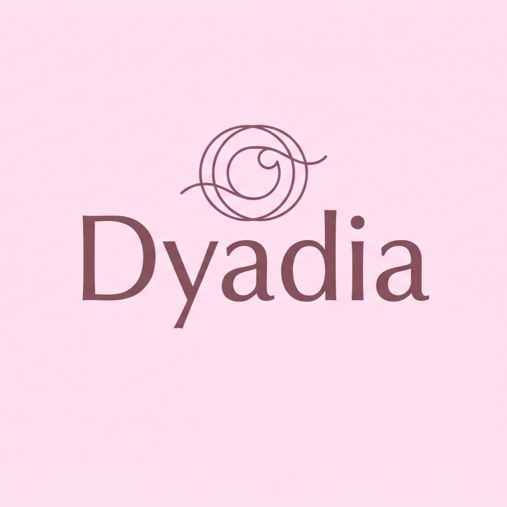

# Dyadia Lens – Korean Beauty Contact Lenses & AI Concierge

<div align="center">
  
  <h3>🌸 Chạm ánh nhìn, bừng cá tính 🌸</h3>
  <p><strong>Website Thương mại Điện tử Kính Áp Tròng Hàn Quốc Cao Cấp & Trợ Lý Ảo AI Concierge</strong></p>

  [](https://react.dev/)
  [](https://www.typescriptlang.org/)
  [](https://tailwindcss.com/)
  [](https://supabase.com/)
  [](https://nodejs.org/)
  [](https://n8n.io/)
</div>

---

## 📖 1. Giới Thiệu Dự Án

**Dyadia Lens** là nền tảng thương mại điện tử chuyên phân phối các dòng kính áp tròng thời trang Hàn Quốc cao cấp (thương hiệu **Hapa Kristin**) chính hãng tại Việt Nam.

Dự án tiên phong giải quyết bài toán nhức nhối của người đeo lens tại Việt Nam: **Bán và định giá theo từng chiếc lens đơn lẻ**, giúp khách hàng bị cận lệch độ có thể tự do chọn độ cận riêng biệt cho Mắt Trái và Mắt Phải mà không cần phải mua 2 hộp đắt đỏ.

Hệ thống tích hợp trợ lý ảo thông minh **Dyadia Concierge** vận hành 24/7 qua quy trình tự động hóa **n8n + LLM**, hỗ trợ tư vấn kiểu dáng, quy đổi độ cận nhãn khoa, tra cứu tồn kho thời gian thực và bảo mật thông tin đơn hàng 2 lớp.

---

## ✨ 2. Tính Năng Nổi Bật

### 🛍️ Trải Nghiệm Khách Hàng (Storefront)
- **Định giá theo 1 chiếc lens lẻ:** Tự do tùy biến độ cận Mắt Trái (L) và Mắt Phải (R), tiết kiệm 50% chi phí cho khách cận lệch độ.
- **Danh mục 35+ sản phẩm chính hãng:** Các bộ sưu tập Hapa Kristin đình đám (*Cat-titude, One&Only, Dolly, First Love, Bean, Secretive, Stay Pretty*) cùng phụ kiện chăm sóc mắt chuyên dụng (*Bausch + Lomb Renu, Opti-Free*).
- **A+ Content & Lookbook K-Beauty:** Trang chi tiết sản phẩm chuẩn tạp chí thời trang, tích hợp Lookbook Instagram kết nối chính thức `@hapakristin.global`.
- **Ưu đãi & Khuyến mãi tự động:** Mã giảm giá `WELCOME10` (giảm 10%), freeship toàn quốc cho đơn từ 299.000đ và tặng kèm khay gương kháng khuẩn cho mọi đơn hàng.
- **Đánh giá & Review sản phẩm:** Hệ thống đánh giá 1-5 sao và phản hồi có xác thực trong 15 ngày sau khi nhận hàng.

### 🤖 Trợ Lý Ảo AI Concierge (n8n + LLM)
- **Tư vấn khúc xạ & thẩm mỹ:** Tự động quy đổi độ cận từ kính gọng sang kính áp tròng theo khoảng cách đỉnh (Vertex Distance).
- **Kiểm tra tồn kho thông minh:** Tự động chuẩn hóa độ cận (-2, 2 độ -> -2.00) và tra cứu số lượng vỉ lens còn lại trong kho theo thời gian thực.
- **Tra cứu đơn hàng bảo mật 2 lớp:** Yêu cầu đồng thời Mã đơn (`DYA-...`) và Số điện thoại đặt hàng; tự động che thông tin cá nhân (Masking SĐT và địa chỉ chi tiết).
- **Rào cản hành vi nghiêm ngặt:** Khóa dải độ tối đa -8.00 độ, bảo vệ bí mật kinh doanh (không lộ số đơn/doanh số), hướng dẫn khách đặt hàng an toàn trên web.

### 🛡️ Quản Trị Hệ Thống (Admin Portal)
- Quản lý danh mục 35 sản phẩm (giá, ảnh mô tả, mô tả A+ Content).
- Quản lý tồn kho biến thể 23 độ cận (từ 0.00 đến -8.00 cho mỗi mẫu lens).
- Quản lý và đổi trạng thái đơn hàng (Chờ xác nhận, Đang giao, Hoàn thành).
- Quản lý danh sách email đăng ký nhận ưu đãi Newsletter.

---

## 🛠️ 3. Công Nghệ Sử Dụng (Tech Stack)

| Phân tầng | Công nghệ | Vai trò trong hệ thống |
| :--- | :--- | :--- |
| **Frontend** | React 19, TypeScript, Vite, Tailwind CSS 4 | Giao diện SPA mượt mà, tối ưu Responsive di động |
| **Backend** | Node.js, Express, tsx | API Gateway, ẩn danh n8n Webhook, tính giá server-side |
| **Cơ sở dữ liệu** | Supabase Cloud (PostgreSQL 15) | Lưu trữ 35+ sản phẩm, tồn kho biến thể, đơn hàng, Auth |
| **Bảo mật** | Supabase Row Level Security (RLS) | Phân quyền truy cập dữ liệu, bảo mật bảng `profiles` |
| **Tự động hóa AI**| n8n Workflow Automation, LangChain Agent | Điều phối Chatbot AI Concierge với bộ 6 công cụ chuyên biệt |
| **Mô hình AI** | OpenAI Chat Model / Google Gemini | Xử lý ngôn ngữ tự nhiên, tư vấn phong cách & nhãn khoa |
| **Lưu trữ CDN** | Supabase Storage (`product-images`) | Phân phối hình ảnh sản phẩm, banner và logo chính thức |

---

## 📁 4. Cấu Trúc Thư Mục Dự Án

```text
dyadia-lens/
├── public/                 # Tài nguyên tĩnh, ảnh banner, lookbook, logo chính thức
│   ├── images/
│   │   ├── banners/        # Ảnh banner 3 bộ sưu tập nổi bật
│   │   ├── lookbook/       # Ảnh Instagram Lookbook (ins-001 đến ins-004)
│   │   └── logo/           # dyadia-logo.jpg chính thức
├── src/                    # Toàn bộ mã nguồn ứng dụng React
│   ├── components/         # Components giao diện (layout, product, chatbot, common)
│   ├── context/            # React Context (AuthContext, CartContext)
│   ├── lib/                # Khởi tạo Supabase client, initialProducts (35 sản phẩm)
│   ├── pages/              # Các trang chính: Home, Products, ProductDetail, About, Cart, Admin...
│   ├── services/           # Tầng dịch vụ API: productService, chatService, siteContentService...
│   └── types/              # Định nghĩa kiểu dữ liệu TypeScript (Product, Order, Variant...)
├── supabase/               # Các kịch bản di chuyển SQL và cấu hình cơ sở dữ liệu
│   ├── migrations.sql      # Tạo bảng product_variants, profiles, RLS
│   ├── fix_orders_setup.sql# Tạo bảng orders, reviews, cập nhật ràng buộc
│   ├── policies_and_faq_setup.sql # 9 Chính sách & 14 FAQ chuẩn
│   └── black_friday_setup.sql
├── n8n/                    # Kịch bản workflow mẫu cho n8n Chatbot AI Concierge
├── server.ts               # Máy chủ Express & API Gateway backend
├── supabase_setup.sql      # File khởi tạo cơ sở dữ liệu Supabase toàn diện một bước
├── index.html              # Điểm vào HTML chính của ứng dụng
├── vite.config.ts          # Cấu hình Vite & Tailwind plugin
├── tsconfig.json           # Cấu hình TypeScript
├── package.json            # Danh sách dependencies & NPM scripts
└── ARCHITECTURE.md         # Tài liệu kiến trúc hệ thống chi tiết (Sơ đồ Mermaid & ERD)
```

---

## 🚀 5. Hướng Dẫn Cài Đặt & Chạy Cục Bộ (Local Development)

### Yêu cầu hệ thống:
- **Node.js:** Phiên bản 18.x trở lên.
- **NPM** hoặc **Yarn** / **PNPM**.

### Các bước thực hiện:

1. **Clone repository về máy:**
   ```bash
   git clone https://github.com/your-username/dyadia-lens.git
   cd dyadia-lens
   ```

2. **Cài đặt các gói phụ thuộc (Dependencies):**
   ```bash
   npm install
   ```

3. **Cấu hình biến môi trường (.env):**
   Tạo tệp `.env` tại thư mục gốc từ mẫu `.env.example`:
   ```bash
   cp .env.example .env
   ```
   Điền thông tin kết nối Supabase và Gemini API:
   ```env
   SUPABASE_URL=https://your-project.supabase.co
   SUPABASE_ANON_KEY=your-supabase-anon-key
   GEMINI_API_KEY=your-gemini-api-key
   VITE_SUPABASE_URL=https://your-project.supabase.co
   VITE_SUPABASE_ANON_KEY=your-supabase-anon-key
   VITE_N8N_CHAT_WEBHOOK_URL=https://your-n8n-instance.com/webhook/dyadia-chat
   ```

4. **Khởi chạy ứng dụng (Development Mode):**
   ```bash
   npm run dev
   ```
   Ứng dụng sẽ khởi chạy tại: `http://localhost:3000`

---

## 🗄️ 6. Khởi Tạo Cơ Sở Dữ Liệu (Supabase Setup)

1. Đăng nhập vào [Supabase Dashboard](https://supabase.com/dashboard).
2. Tạo một dự án mới (hoặc dùng dự án hiện có).
3. Vào mục **SQL Editor** $\rightarrow$ Nhấn **New query**.
4. Mở tệp `supabase_setup.sql` trong dự án, dán toàn bộ nội dung và nhấn **Run**.
5. Trong mục **Storage**, tạo một Bucket công khai tên là `product-images` để lưu trữ ảnh sản phẩm.

---

## 📄 7. Tài Liệu Kiến Trúc Chi Tiết
Để xem sơ đồ khối 4 tầng, mô hình thực thể ERD và luồng dữ liệu tự động hóa của n8n, vui lòng tham khảo:
👉 **[Tài liệu Kiến trúc Hệ thống Dyadia Lens (ARCHITECTURE.md)](ARCHITECTURE.md)**

---

## ⚖️ 8. Bản Quyền & Giấy Phép
Dự án được phát triển phục vụ đồ án thương mại điện tử và phân phối kính áp tròng thời trang Hàn Quốc chính hãng.  
© 2026 **Dyadia Lens**. Mọi quyền được bảo lưu.
